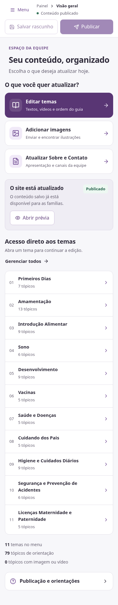

# Comparação visual da página inicial e do painel

A rodada anterior concentrou mudanças em busca e edição. A página inicial pública e a visão geral administrativa ainda mantinham a mesma organização. Esta revisão modifica a estrutura das duas telas.

## Site público

- O grande bloco de apresentação foi substituído por um cabeçalho compacto.
- A busca continua acessível no topo, ampliada no desktop.
- **Primeiros Dias** aparece em destaque, seguido por cartões clicáveis dos temas.
- No celular há duas colunas; em telas abaixo de 360 px, uma lista compacta preserva a leitura.

| Antes | Agora |
| --- | --- |
|  |  |

## Administração

- As tarefas de editar temas, adicionar imagens e atualizar Sobre/Contato aparecem primeiro.
- A situação de publicação ocupa um painel compacto abaixo das tarefas.
- A lista de temas permite abrir diretamente o conteúdo a editar.
- Datas e explicações detalhadas de publicação ficam numa seção recolhível.

| Antes | Agora |
| --- | --- |
|  |  |

As fontes, os conteúdos e os fluxos de salvar, visualizar e publicar foram preservados. As capturas são de uma instalação local de revisão; não comprovam atualização do servidor de produção.
